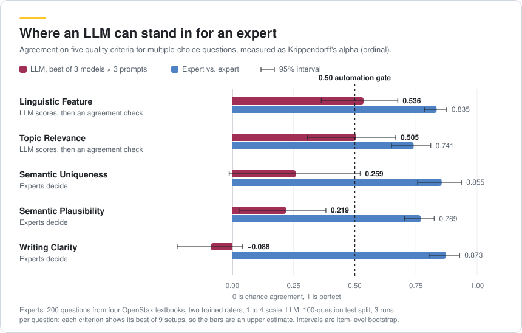
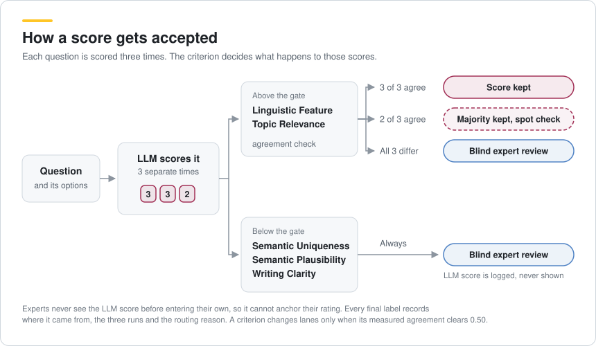
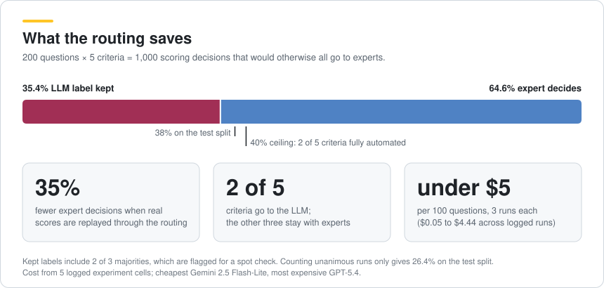
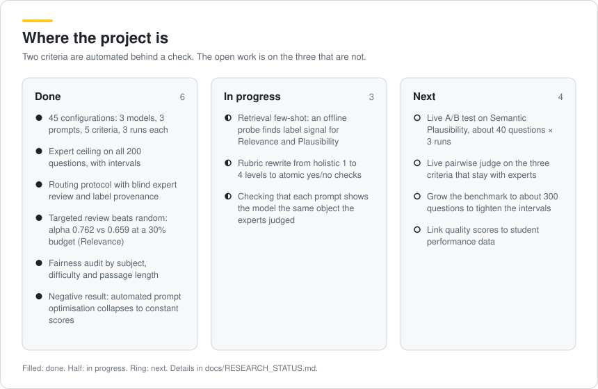

# LLM as Judge (Annotating)


A hybrid pipeline for rating the quality of multiple-choice questions. An LLM scores the criteria it can be trusted with, and everything else goes to expert reviewers who never see the model's score.

We measured how closely three LLMs agree with two trained experts on five rubric criteria. The answer depends on the criterion. On two of them the best model clears our 0.50 gate, and its score is kept when three independent runs agree. On the other three it falls far short of the experts, so those stay with people. Replaying real scores through this routing removes about a third of the expert decisions.

Built at the [ASU Learning Engineering Institute](https://lei.asu.edu). This is a research prototype and the results are preliminary.

<p align="center"></p>

## Contents

- [The question](#the-question)
- [What we found](#what-we-found)
- [How a score gets accepted](#how-a-score-gets-accepted)
- [What the routing saves](#what-the-routing-saves)
- [Where the project is](#where-the-project-is)
- [Running it](#running-it)
- [Dashboard tabs, and what is real](#dashboard-tabs-and-what-is-real)
- [Repository layout](#repository-layout)
- [Figures you can share](#figures-you-can-share)
- [FAQ](#faq)
- [Related work](#related-work)
- [Contact and citation](#contact-and-citation)

## The question

Expert review is the slow step in building a question bank. Every question in our benchmark was rated 1 to 4 by two trained experts on five criteria:

| Criterion | What the expert judges |
|-----------|------------------------|
| Linguistic Feature | Does each wrong option match the correct answer in length, structure and style? |
| Topic Relevance | Do the options address a central concept from the source text? |
| Semantic Uniqueness | Does each wrong option offer a different wrong idea? |
| Semantic Plausibility | Would a student who read the text without understanding it find the wrong option believable? |
| Writing Clarity | Is the question stem worded clearly and concisely? |

The benchmark is 200 questions drawn from four OpenStax social-science textbooks (Sociology, History, Anthropology, Lifespan Development). We asked which of these criteria an LLM can take over, and how to build a review workflow around the answer.

## What we found

We tested three models (Gemini 2.5 Flash-Lite, Gemini 2.5 Flash, GPT-5.4) with three prompts (zero-shot, a strict rubric prompt, and an automatically optimised prompt), three runs per question at temperature 0.3, on a 100-question test split. Agreement is Krippendorff's alpha, ordinal: 0 is chance, 1 is perfect, and 0.67 is the usual bar for tentative conclusions. Intervals are 95% item-level bootstrap.

| Criterion | Experts vs. each other | Best LLM vs. experts | Best setup | Route |
|-----------|------------------------|----------------------|------------|-------|
| Linguistic Feature | 0.835 (0.785 to 0.876) | 0.536 (0.364 to 0.676) | Gemini 2.5 Flash, zero-shot | LLM, then agreement check |
| Topic Relevance | 0.741 (0.650 to 0.810) | 0.505 (0.306 to 0.668) | GPT-5.4, rubric prompt | LLM, then agreement check |
| Semantic Uniqueness | 0.855 (0.757 to 0.936) | 0.259 (−0.013 to 0.522) | Gemini 2.5 Flash, zero-shot | Experts |
| Semantic Plausibility | 0.769 (0.703 to 0.825) | 0.219 (0.027 to 0.382) | GPT-5.4, zero-shot | Experts |
| Writing Clarity | 0.873 (0.803 to 0.929) | −0.088 (−0.226 to 0.041) | GPT-5.4, rubric prompt | Experts |

How to read it:

- The split follows the kind of judgment. Linguistic Feature and Topic Relevance have surface cues a model can pick up. The other three need a judgment about meaning, and no model or prompt we tried comes close to the experts on them.
- The gate is 0.50, lower than the usual 0.67, because alpha alone never accepts a score: run agreement is checked behind it. Both passing intervals cross 0.50, so we treat the two automated criteria as provisional until the benchmark grows to about 300 questions.
- Each row shows the best of nine setups for that criterion, so the LLM numbers are an upper estimate. The winning setup also differs by criterion.
- On Writing Clarity the best setup puts 95% of questions on a single score while the experts spread them across the scale, which is why alpha goes below zero.
- Automated prompt optimisation made agreement worse. The optimiser learned the label distribution instead of the task and collapsed to constant scores on three criteria.

A note on estimators. These numbers compare the median of the LLM's three runs with the rounded average of the two experts ([`compute_bootstrap_cis.py`](scripts/compute_bootstrap_cis.py)). [docs/METHODOLOGY.md](docs/METHODOLOGY.md) also reports alpha against the unrounded expert mean on the same items, which gives 0.558 for Linguistic Feature and 0.461 for Topic Relevance. Topic Relevance clears the gate under one estimator and sits just under it under the other, one more reason to read the tiering as provisional.

## How a score gets accepted

<p align="center"></p>

1. The LLM scores each question three times, independently, at temperature 0.3. Agreement between the runs is the confidence signal. We tried the model's self-reported confidence first and dropped it: it sat near 94% on almost every question, with an expected calibration error of 0.70.
2. The criterion decides the lane ([`dimension_router.py`](src/pipeline/dimension_router.py)). Criteria whose measured agreement clears the gate go through an agreement check. Criteria below it always go to experts.
3. Above the gate, a unanimous score is kept, a 2 of 3 majority is kept and flagged for a spot check, and a three-way split goes to an expert ([`confidence_gate.py`](src/pipeline/confidence_gate.py)). The code also has a middle tier that keeps only unanimous scores; no criterion falls in it with the current results.
4. Expert review is blind. Reviewers enter their score before they can see the model's, so it cannot anchor them.
5. Every final label records its source, the three runs, the agreement level and the routing reason ([`aggregator.py`](src/pipeline/aggregator.py)).

## What the routing saves

<p align="center"></p>

| Measure | Value | Source |
|---------|-------|--------|
| Expert decisions removed, pipeline replay | 35.4% of 1,000 | cached experiment scores replayed through the API |
| Same, best setups on the test split | 38.0% | `item_level_routing.csv` |
| Same, counting unanimous runs only | 26.4% | `item_level_routing.csv` |
| Ceiling with 2 of 5 criteria automated | 40% | 2 of 5 criteria |
| LLM cost per 100 questions, 3 runs each | $0.05 to $4.44 | call logs from 5 of the 9 setups |

Two caveats. The kept labels include 2 of 3 majorities flagged for a spot check; if each spot check costs a full expert decision, the saving falls toward the unanimous-only figure. And the cost logs cover five setups, from Gemini 2.5 Flash-Lite at the low end to GPT-5.4 at the high end. The two setups behind the automated criteria were not among the logged runs.

## Where the project is

<p align="center"></p>

The most promising lead for the three hard criteria is retrieval. An offline nearest-neighbour probe over the 200 expert-labelled questions found that similar labelled examples carry signal for Semantic Plausibility (mean absolute error 0.74 with retrieval, 0.88 without) and Topic Relevance, while it hurts Linguistic Feature, where the cues are about form rather than meaning. A live test with the LLM is the next experiment.

What is done, in progress and open, with the reason behind each dead end, is in [docs/RESEARCH_STATUS.md](docs/RESEARCH_STATUS.md).

## Running it

What works from a fresh clone, and what needs files we have not published yet:

| Part | Fresh clone | Needs |
|------|-------------|-------|
| Pipeline modules in `src/` | yes | nothing |
| Test suite | 44 pass, 10 skip | the skipped tests read the private `Data/` and `prompts/` folders; with them, all 54 pass |
| Dashboard, Workspace tab | yes | nothing; it runs on mock data |
| Dashboard, R&D Findings tab | shows a notice | `dashboard/src/data/findingsData.js`, generated from `Data/` |
| Dashboard API tabs, replay and live annotation | no | `Data/` for replay; `prompts/` and an API key for live scoring |

To try the routing demo without any data:

```bash
cd dashboard && npm install && npm run dev
```

Open http://localhost:5173 and use the Workspace tab. With the data in place, run the full stack:

```bash
pip install -r requirements.txt
cd dashboard && npm install && cd ..
python scripts/preflight.py
```

```bash
python -m uvicorn src.api.server:app --port 8000
```

```bash
cd dashboard && npm run dev
```

The dashboard opens at http://localhost:5173. On Windows, `START_DEMO.bat` runs all of the above. For live scoring, copy `.env.example` to `.env` and fill in the providers you use; replay mode costs nothing. If you would like access to the data or prompts, see [Contact and citation](#contact-and-citation).

## Dashboard tabs, and what is real

Two tabs do not show measured results. Read this before demoing.

| Tab | Data source | Shows measured results |
|-----|-------------|------------------------|
| R&D Findings | result CSVs, compiled at build time | yes, every figure traces to a CSV |
| Pipeline | live or replayed annotation | partly: items outside the replay cache get synthetic scores |
| Active Learning | experiment output | yes |
| Fairness Audit | experiment output | yes |
| Workspace | mock data | no, illustrative only |
| Pairwise Elo | simulated judge | no, the judge is the median plus noise |

Both gaps are open items. `_runs_for_item()` in [`server.py`](src/api/server.py) generates synthetic runs for uncached items, and `/api/elo/run` does not call a real pairwise judge.

## Repository layout

```
src/pipeline/        annotation engine, dimension router, confidence gate, aggregator,
                     active selector, fairness audit, pairwise Elo, metrics
src/api/             FastAPI server behind the dashboard
scripts/             experiment runners, analysis, figure and data builders, preflight
dashboard/           React and Vite interface (see dashboard/README.md)
tests/               pytest suites for the pipeline stages
docs/                architecture, methodology, research status
docs/images/         README figures (SVG) and share/ (PNG)
```

Not in the repository: expert annotations, source questions, prompts, papers in progress and internal planning notes. See the FAQ for why.

| Document | Covers |
|----------|--------|
| [docs/ARCHITECTURE.md](docs/ARCHITECTURE.md) | Pipeline stages, routing logic, data flow |
| [docs/METHODOLOGY.md](docs/METHODOLOGY.md) | Measurement design and the reason for each estimator |
| [docs/RESEARCH_STATUS.md](docs/RESEARCH_STATUS.md) | Done, in progress, open |
| [dashboard/DESIGN_SYSTEM.md](dashboard/DESIGN_SYSTEM.md) | Interface design rules |
| [DEPLOY.md](DEPLOY.md) | Deploying the dashboard behind a password |

## Figures you can share

The figures above are SVGs that follow your GitHub theme. PNG copies at 2x, on a light background, are in [docs/images/share](docs/images/share) for slides and posts:

| Figure | PNG |
|--------|-----|
| Where an LLM can stand in for an expert | [reliability.png](docs/images/share/reliability.png) |
| How a score gets accepted | [routing.png](docs/images/share/routing.png) |
| What the routing saves | [workload.png](docs/images/share/workload.png) |
| Where the project is | [roadmap.png](docs/images/share/roadmap.png) |

A QR code that opens this page is in [docs/images/qr-github.png](docs/images/qr-github.png) ([SVG](docs/images/qr-github.svg) for print).

The data figures are generated, not drawn. `python scripts/build_readme_figures.py` rebuilds all four from the result files; edit the `ROADMAP` list in that script when the status changes.

## FAQ

### Why "hybrid" and not "LLM annotator"?

Because that is what the evidence supports. Three of five criteria carry no usable model signal, and on the two that do, the model reaches about two thirds of the agreement a second expert gives. The useful part of the system is deciding which judgments to hand over and sending the rest to a person.

### Why is the gate 0.50 when 0.67 is the usual bar?

Passing the gate does not accept a score. It only makes a criterion eligible for the agreement check, and a split between runs still goes to an expert. A stricter gate would automate nothing with the current models.

### Are the LLM numbers cherry-picked?

Partly, and on purpose. Each criterion shows its best of nine setups, which answers "can any setup we tried do this?" It overstates what a single fixed setup would do, and we say so on the chart. Across the full grid of 45 results, alpha runs from −0.36 to 0.54.

### Could the models have seen these questions during training?

Possibly. OpenStax is public and likely in pre-training data. A reanalysis split by contamination risk is on the open list.

### Why are the data and prompts not here?

The expert annotations belong to named raters and their release is pending review. The source questions are OpenStax content under CC BY-NC-SA. The prompts and results are part of papers in progress. We will add what we can once those are settled.

### Can I run it on my own questions?

The input handler takes a CSV with `question_uuid`, `text` (the source passage), `question` and `answer` columns; the optional columns are listed in [`input_handler.py`](src/pipeline/input_handler.py). Live scoring needs prompts and an API key; the routing tiers come from our benchmark, so on a different question set they should be re-measured before you trust them.

## Related work

From the same team, on reviewing wrong answer options with interpretable evidence rather than automated verdicts:

Banawan, M., Chakraborty, S., Christhilf, K., Huynh, L., Arner, T., and McNamara, D. (2026). Supporting distractor quality review through interpretable semantic and lexical diagnostics. Proceedings of AIME-Con: Full Papers, 253–259. [aclanthology.org/2026.aimecon-main.28](https://aclanthology.org/2026.aimecon-main.28)

## Contact and citation

Shubham Chakraborty and Michelle Banawan, Learning Engineering Institute, Arizona State University. Contact us at {schak103, mbanawan}@asu.edu.

This work is in progress. Please contact us before citing it, since the numbers above may change as the benchmark grows.

License: not chosen yet. Until one is added, the code is all rights reserved. Source questions are OpenStax content under CC BY-NC-SA and are not distributed here.
